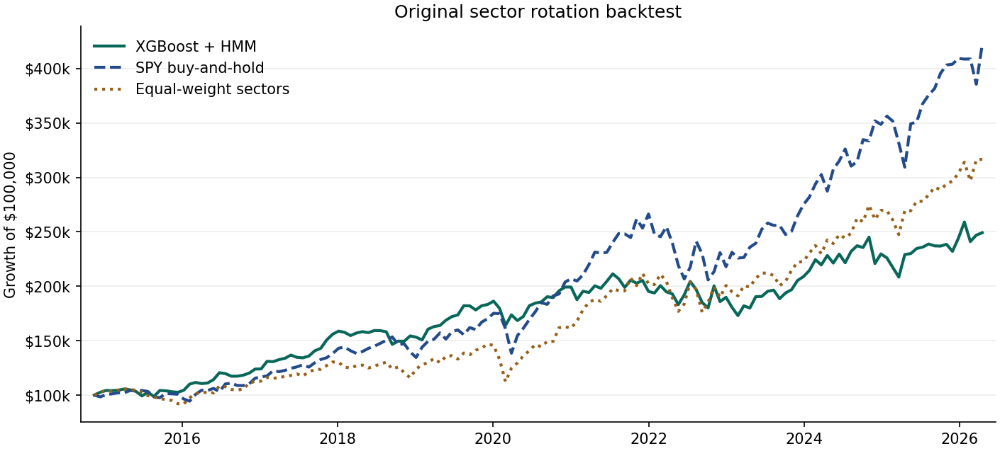
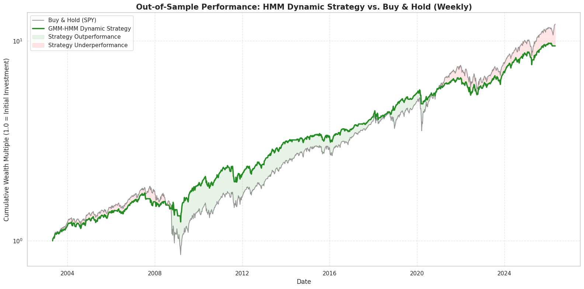
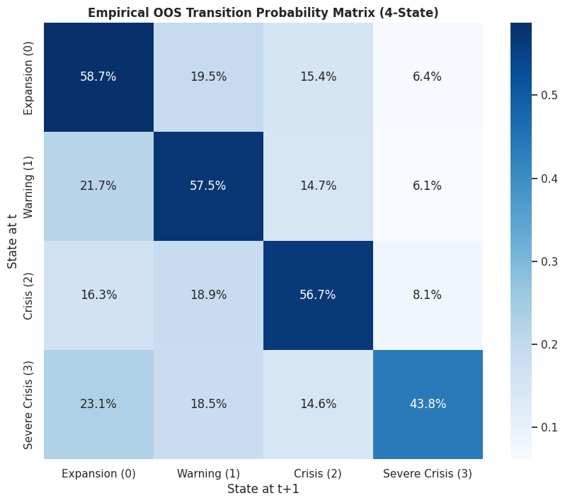
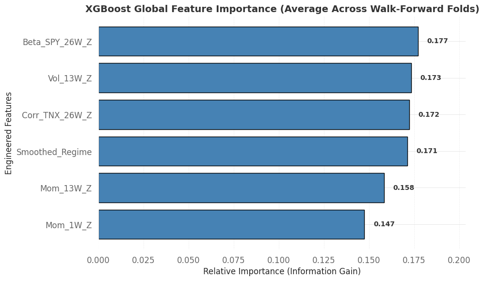
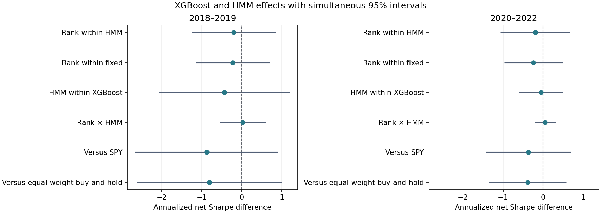

# Regime-Aware Sector Rotation

Can a four-state market regime model make a U.S. sector rotation strategy less exposed to drawdowns? The HMM sets the equity budget. An XGBoost ranker decides which sector ETFs to hold. SPY and equal-weight sectors give the two decisions a benchmark.

[Open the Plotly dashboard](https://yuvipaloozie.github.io/Regime-Aware-Sector-Trading/)


## Historical results

The published archive covers November 14, 2014 through April 17, 2026. The original portfolio had a shallower drawdown than either benchmark at the saved marks. SPY and equal-weight sectors finished ahead on CAGR, Sharpe, and Sortino.

| Portfolio | Total return | CAGR | Sharpe | Sortino | Max drawdown |
|---|---:|---:|---:|---:|---:|
| Original XGBoost + HMM | 149.17% | 8.29% | 0.71 | 1.12 | −18.15% |
| SPY buy-and-hold | 322.17% | 13.39% | 0.93 | 1.50 | −22.73% |
| Archived equal-weight sectors | 216.66% | 10.58% | 0.80 | 1.27 | −23.49% |



The original terminal labeled its compounded equal-weight sector benchmark as SPY. The dashboard relabels that series and adds SPY from adjusted closes on the same dates. Ratios use 13 four-week periods per year and a zero return hurdle. Drawdown uses the same marks, so it can miss losses between marks. The saved regime and fill ledger starts on May 17, 2024.

Two details limit the original result. The HMM inferred states for an entire four-week prediction block at once, so a later observation could influence an earlier state. The ranker could also train on an outcome that reached the first test date. The archive preserves the original simulation. It includes 104 simulated fills and has no connection to a broker.

## How the models work

The [regime notebook](notebooks/Regime_Classifier.ipynb) fits a Gaussian HMM to weekly market and macro data, including SPY returns, the VIX, the yield curve, financial stress, and inflation. It refits on a rolling five-year window. The original terminal ordered the four states by mean VIX and mapped them to 100%, 80%, 50%, and 0% sector equity targets. The terminal invested the rest in TLT. The standalone notebook ordered its states by mean training return and used a zero-return cash sleeve for its SPY timing experiment.

<details>
<summary>Original HMM timing, transition matrix, and feature importance</summary>



The standalone notebook printed a Sharpe of 0.85 for HMM timing and 0.72 for SPY. It used weekly returns and ignored trading costs. Those results come from a different test than the combined portfolio above.





</details>

The [sector notebook](notebooks/Sector_Rotation_Strategy.ipynb) uses XGBoost's `rank:pairwise` objective. Each training group is a week of sector ETFs. The target is each sector's subsequent four-week return relative to the sector average. The strategy holds two sectors and gives an incumbent a one-rank buffer to reduce turnover.

## Corrected backtest

The revised Python pipeline filters HMM state probabilities forward in time. The ranker drops training labels whose return horizon overlaps the test period. State probabilities scale exposure, and the defensive sleeve chooses among SHY, IEF, TLT, and cash. The test fills at the next market close, charges 5 basis points per traded dollar, and values the portfolio daily.

In July 2018 through December 2019 and January 2020 through December 2022, the corrected strategy had smaller drawdowns and lower CAGR, Sharpe, and Sortino than both benchmarks. A paired bootstrap drew 4,000 samples with blocks averaging 21 trading sessions. All four simultaneous 95% intervals for the Sharpe differences crossed zero.



## Run the dashboard

```bash
npm ci --prefix dashboard
npm run dev --prefix dashboard
```

The frontend reads the checked-in [archive](dashboard/public/archive.json). Use the chart to compare portfolios, then select a rebalance date to see its allocation and fills. The full fill ledger is downloadable as CSV. Plotly draws the chart. The range selector and fill tabs adapt [Toggle Group](https://21st.dev/@shadcn/components/toggle-group) and [Tabs](https://21st.dev/@shadcn/components/tabs) from shadcn/ui on 21st.dev. The panel layout takes cues from [Interactive Brokers' Mosaic workspace](https://www.interactivebrokers.com/en/trading/tws.php).

Build the static site with `npm run build --prefix dashboard`. GitHub Pages serves that output from the `gh-pages` branch. For a Git-connected Vercel deployment, import this repository with the root directory set to the repository root. [`vercel.json`](vercel.json) supplies the install command, build command, and output directory. The archive needs no environment variables. [Vercel Git deployment docs](https://vercel.com/docs/git)

## Run the research pipeline

```bash
python -m venv .venv
source .venv/bin/activate  # Windows: .venv\Scripts\activate
pip install -r requirements.txt
python regime_sector_rotation/main.py --demo --force-refresh
```

Demo mode uses synthetic data. For a market-data run, set `FRED_API_KEY` in your environment and run `python regime_sector_rotation/main.py --force-refresh`. The pipeline uses Yahoo Finance adjusted prices and initial-release macro observations from FRED. It stops if required real-data ingestion fails. Each run saves a manifest, weights, equity paths, simulated fills, and a QuantStats tearsheet under `regime_sector_rotation/`. Those files are separate from the dashboard's historical snapshot.

```bash
python -m unittest discover -s regime_sector_rotation/tests -v
```

[MIT License](LICENSE)
